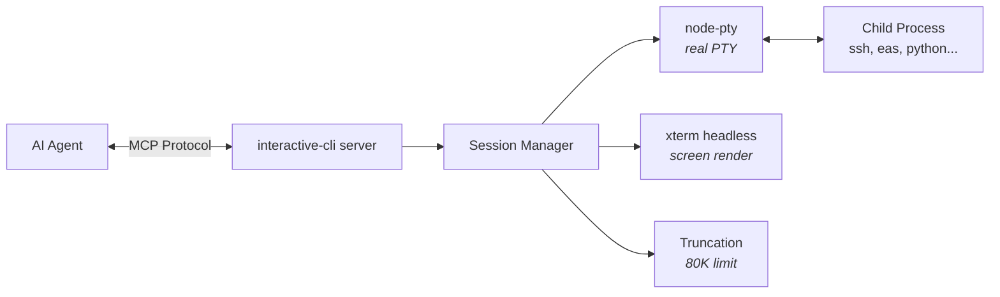
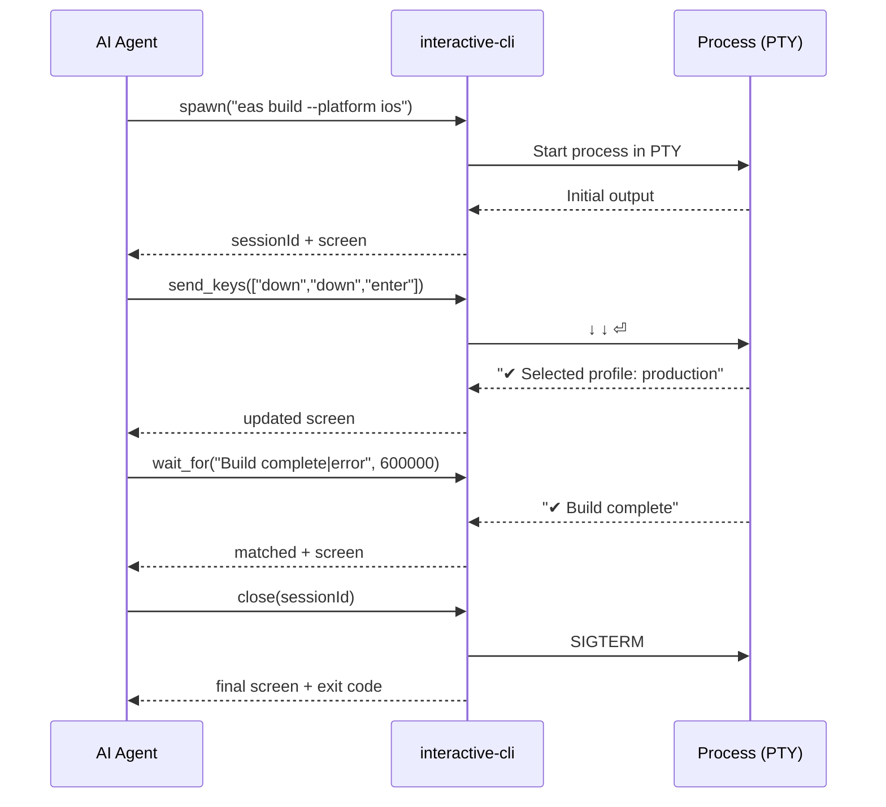

# interactive-cli

An MCP server that runs commands in a real pseudo-terminal and hands your AI agent the rendered screen, so it can answer prompts, pick menu items and drive REPLs, SSH and installers the way you would.

[](https://www.npmjs.com/package/interactive-cli-mcp)
[](LICENSE)


Site: **https://ohernandezdev.github.io/interactive-cli/**

Works with Claude Code, Codex, Cursor, Windsurf, or any MCP client that speaks stdio.

## Why

A shell tool sends a command and waits for it to finish. An interactive command never finishes: it waits for a person. The agent hangs, times out or kills it, and you end up typing the answer yourself.

```
$ npm init
package name: (my-app)
waiting for input…
```

interactive-cli bridges that gap. It spawns the process in a PTY, renders the screen with xterm headless (clean text, no ANSI escape soup), and lets the agent send input or keys and wait for patterns.

## Install

Requires Node 18 or later, on macOS or Linux.

### Claude Code

```bash
claude mcp add interactive-cli -- npx -y interactive-cli-mcp
```

### Codex CLI

```bash
codex mcp add interactive-cli -- npx -y interactive-cli-mcp
```

This writes `[mcp_servers.interactive-cli]` with `command = "npx"` and `args = ["-y", "interactive-cli-mcp"]` to `~/.codex/config.toml`.

### Cursor

Add this to `~/.cursor/mcp.json`:

```json
{
  "mcpServers": {
    "interactive-cli": {
      "command": "npx",
      "args": ["-y", "interactive-cli-mcp"]
    }
  }
}
```

### Any MCP client

Point a stdio MCP client at:

```bash
npx -y interactive-cli-mcp
```

### From source

```bash
git clone https://github.com/ohernandezdev/interactive-cli.git
cd interactive-cli
npm install && npm run build
claude mcp add interactive-cli -- node /absolute/path/to/interactive-cli/dist/index.js
```

## What a session looks like

An illustrative `eas build` session. The agent calls the tools; the server answers with the rendered screen.

```
spawn("eas build --platform ios")
  ? Select a build profile ›
  ❯ development
    preview
    production

get_screen()
  (same screen)

send_keys(["down", "down", "enter"])
  ✔ Selected profile: production
  ? Do you want to log in to your Apple account? › (Y/n)

send_input("y")
  ✔ Logged in
  Building…

wait_for("Build complete|error", 600000)
  ✔ Build complete

close()
  exit 0
```

(`sessionId` is omitted above for brevity; every call after `spawn` takes the id that `spawn` returned.)

## Tools

| Tool | Parameters (defaults) | Read-only |
|------|-----------------------|-----------|
| `spawn` | `command`, `cwd?`, `env?`, `cols = 120`, `rows = 30`, `waitMs = 2000` | No |
| `send_input` | `sessionId`, `text`, `pressEnter = true`, `waitMs = 2000` | No |
| `send_keys` | `sessionId`, `keys[]`, `delayBetweenMs = 50`, `waitMs = 1500` | No |
| `get_screen` | `sessionId`, `search?`, `waitMs = 500` | Yes |
| `wait_for` | `sessionId`, `pattern`, `timeoutMs = 30000`, `intervalMs = 1000` | No |
| `wait_for_exit` | `sessionId`, `timeoutMs = 30000` | No |
| `resize` | `sessionId`, `cols`, `rows` | No |
| `list_sessions` | none | Yes |
| `close` | `sessionId` | No |

- `spawn` runs the command as `$SHELL -c "<command>"` (`/bin/zsh` when `SHELL` is unset), so pipes, redirects and builtins work. `env` is merged with the current environment. `waitMs` is how long to wait for the first output.
- `send_input` appends Enter unless `pressEnter` is `false`, which types without submitting (useful for forms and password fields).
- `send_keys` sends the keys in order with `delayBetweenMs` between them, then waits `waitMs`.
- `get_screen` waits `waitMs` before capturing (default 500; `0` for an instant capture). `search` is a regex: the result adds the matching lines with 2 lines of context.
- `wait_for` takes a regex, matched case-insensitively. Use a long `timeoutMs` for builds.
- `close` sends SIGTERM, then SIGKILL if needed, and returns the final screen.
- `spawn`, `send_input`, `send_keys` and `close` are annotated as destructive, so clients such as Claude Code ask before using them. `get_screen` and `list_sessions` are annotated read-only.
- Every result is JSON.

### Keys

`send_keys` accepts: `enter` `tab` `escape` `space` `up` `down` `left` `right` `backspace` `delete` `home` `end` `page_up` `page_down` `f1` to `f12` `ctrl+c` `ctrl+d` `ctrl+z` `ctrl+l` `ctrl+a` `ctrl+e` `ctrl+r` `ctrl+w` `ctrl+u` `ctrl+k` `ctrl+p` `ctrl+n` `y` `n` `0` to `9`

## Resources

- `interactive-cli://sessions`: JSON list of all sessions
- `interactive-cli://sessions/{sessionId}/screen`: live screen content of a session (text/plain)

## Prompts

Prompt templates for common flows. In Claude Code they appear as slash commands (`/mcp__interactive-cli__eas_build`).

| Prompt | Arguments |
|--------|-----------|
| `eas_build` | `platform?` (default `ios`), `profile?` (default `production`), `cwd?` |
| `ssh_session` | `host` (`user@hostname`), `commands?` (semicolon-separated) |
| `repl_session` | `command` (`python3`, `node`, `psql`, ...), `setup?` (semicolon-separated) |
| `docker_interactive` | `image`, `shellCmd?` (default `/bin/sh`) |

`eas_build` runs `eas build --platform <platform> --profile <profile> --auto-submit`. `docker_interactive` runs `docker run -it <image> <shellCmd>`.

## How it works



- **node-pty** spawns a real pseudo-terminal (`xterm-256color`), so the child process behaves as it does in your terminal.
- **xterm headless** keeps a virtual terminal (1,000 lines of scrollback) and renders it into a clean 2D text grid.
- Screens are capped at 80,000 characters, cut in the middle with a marker so the start and the end survive. Claude Code caps tool results at 100,000.

Typical flow:



## Limits

- macOS and Linux only. Commands run through your shell (`$SHELL -c`), and Windows is not supported.
- Any screen in a result is capped at 80,000 characters.
- Scrollback is 1,000 lines.
- The agent runs commands with your permissions, in your shell. Review what your client approves.

## Development

```bash
npm install
npm run build
node dist/index.js
```

Dependencies: `@modelcontextprotocol/sdk`, `node-pty`, `@xterm/headless`, `zod`.

## License

MIT
